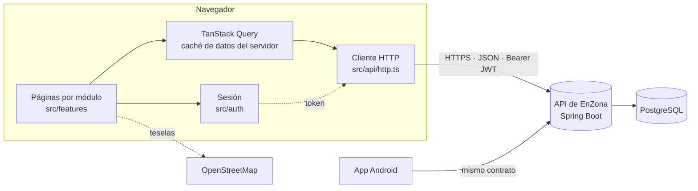
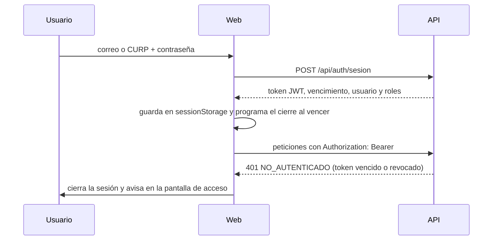
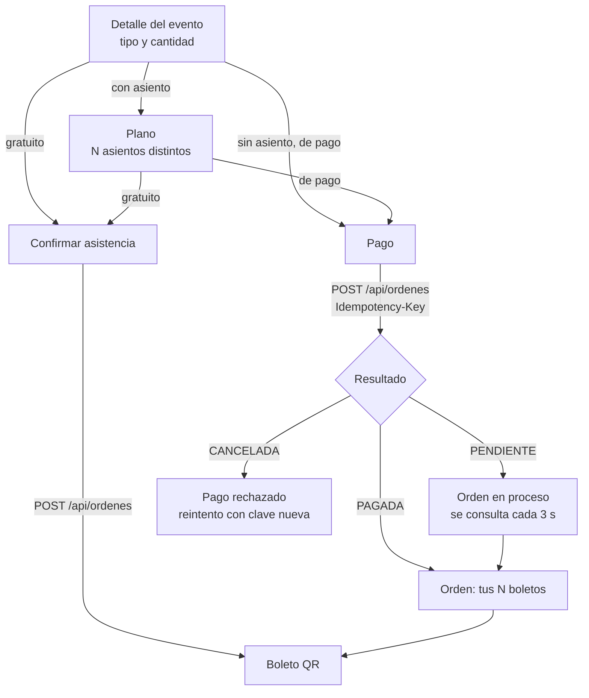

# Arquitectura

EnZona Web es una aplicación de página única (SPA) que se compila a archivos estáticos y habla con la API de EnZona por HTTPS. No guarda datos propios en un servidor: todo el estado de negocio vive en la API (Anexo E, arquitectura cliente-servidor con API REST compartida por la web y Android).

## Capas

| Capa           | Carpeta                    | Responsabilidad                                                         | Depende de                          |
| -------------- | -------------------------- | ----------------------------------------------------------------------- | ----------------------------------- |
| Presentación   | `src/features/*`, `src/ui` | Pantallas, componentes de la marca, estados de carga y error            | `app`, `auth`, `api`, `lib`, `ui`   |
| Aplicación     | `src/app`                  | Rutas, guardas por rol, marco con navegación, configuración de la caché | `auth`, `features` (carga diferida) |
| Sesión         | `src/auth`                 | Token, usuario y roles; cierre por vencimiento o por 401                | `api`                               |
| Acceso a datos | `src/api`                  | Un módulo por recurso, tipos del contrato y manejo uniforme de errores  | `config`                            |
| Utilidades     | `src/lib`                  | Funciones puras: fechas, formato, validaciones, errores, filtros        | —                                   |
| Configuración  | `src/config`               | Variables `VITE_*` tipadas                                              | —                                   |

Las dependencias van hacia abajo: una página puede usar `api` y `lib`, pero `api` no conoce React ni las páginas. Las utilidades de `lib` no tienen efectos y se prueban de forma aislada.

## Módulos funcionales

Cada carpeta de `src/features` agrupa lo de un caso de uso: la página (`*Page.tsx`), sus componentes, su hoja de estilos (`*.module.css`) y sus pruebas (`*.test.tsx`). Las pantallas se cargan bajo demanda con `React.lazy`, de modo que la primera visita solo descarga el marco y la pantalla que se abre. Las librerías pesadas también se cargan cuando hacen falta:

| Librería                | Se carga al abrir                         | Tamaño aproximado (gzip) |
| ----------------------- | ----------------------------------------- | ------------------------ |
| Leaflet + React Leaflet | Un mapa (detalle del evento o formulario) | 45 kB                    |
| ZXing                   | El escáner del validador                  | 110 kB                   |
| qrcode                  | Un boleto                                 | 12 kB                    |

## Acceso a datos

`src/api/http.ts` es el único lugar que llama a `fetch`:

- Agrega `Authorization: Bearer <token>` salvo en los endpoints públicos (`autenticada: false`).
- Corta la petición a los 20 s y combina esa señal con la de cancelación de React Query.
- Convierte cualquier respuesta de error en `ApiError` con el `codigo` estable de la API (Problem Details, RFC 9457) y los errores por campo. Una falla de red se convierte en el código `SIN_CONEXION`.
- Solo un `401 NO_AUTENTICADO` cierra la sesión. Un `401 CREDENCIALES_INVALIDAS` (por ejemplo, la contraseña actual incorrecta al cambiarla) se queda en el formulario.
- `peticionPaginada` lee la paginación de las cabeceras `X-Total-Count`, `X-Page`, `X-Page-Size` y `X-Total-Pages`.

Los textos de error se eligen en el cliente a partir del `codigo` (`src/lib/errores.ts`), para no depender del `detail` del servidor. Para `REGLA_NEGOCIO`, `POLITICA_MODIFICACION` y `ROL_EN_USO` se muestra el `detail`, porque explica qué regla se incumplió.

## Estado

| Tipo de estado             | Dónde vive                                                                | Ejemplo                                                         |
| -------------------------- | ------------------------------------------------------------------------- | --------------------------------------------------------------- |
| Datos del servidor         | TanStack Query (`src/app/consultas.ts`, claves centralizadas en `claves`) | eventos, boletos, reportes                                      |
| Sesión                     | `SesionProvider` + `sessionStorage`                                       | token, vencimiento, usuario y roles                             |
| Estado navegable           | La URL                                                                    | filtros de Inicio, cantidad y asientos elegidos, pedido de pago |
| Preferencias del navegador | `localStorage`                                                            | zona elegida y uso de la ubicación                              |
| Estado de la pantalla      | `useState`                                                                | formularios, diálogos                                           |

La caché solo reintenta fallas de red o del servidor (5xx); un 4xx es una respuesta definitiva. Tras una escritura se invalidan las claves afectadas (por ejemplo, después de una compra: `evento`, `asientos`, `eventos` y `boletos`).

Guardar los filtros y la selección en la URL permite recargar, compartir el enlace o volver desde el pago sin perder lo elegido.

## Sesión y roles

- El token se guarda en `sessionStorage`: se borra al cerrar la pestaña y no se comparte entre pestañas. La API no ofrece token de renovación, así que al vencer se vuelve a iniciar sesión.
- El cliente HTTP toma el token del proveedor de sesión, que se configura en su primer render (antes de que cualquier pantalla pida datos).
- Al iniciar o cerrar sesión se vacía la caché de consultas: ningún dato de una cuenta queda visible para la siguiente.
- Hay dos accesos, como en Android: el normal (asistentes) y el del personal (organizador, validador y administrador). El administrador solo entra por el del personal.
- Los roles se acumulan. La navegación muestra una pestaña por rol (`src/app/navegacion.ts`) y `RequiereRol` protege cada ruta; la API vuelve a comprobar el permiso en cada petición.

## Rutas

| Ruta                                                                                                        | Pantalla                | Acceso                               |
| ----------------------------------------------------------------------------------------------------------- | ----------------------- | ------------------------------------ |
| `/acceso`, `/acceso/personal`, `/registro`, `/verificacion`                                                 | Identidad               | Sin sesión                           |
| `/`                                                                                                         | Inicio (descubrimiento) | Sesión                               |
| `/eventos/:id`, `/eventos/:id/asientos`                                                                     | Detalle y plano         | Sesión                               |
| `/pago`, `/ordenes/:id`                                                                                     | Pago y resultado        | Sesión                               |
| `/boletos`, `/boletos/:id`                                                                                  | Mis boletos y boleto QR | Sesión                               |
| `/perfil`, `/perfil/datos`, `/perfil/seguridad`                                                             | Mi cuenta               | Sesión                               |
| `/organizador`, `/organizador/eventos/nuevo`, `/organizador/eventos/:id`, `/organizador/eventos/:id/editar` | Organizador             | Rol ORGANIZADOR                      |
| `/validador`                                                                                                | Escáner                 | Rol VALIDADOR, ORGANIZADOR o ADMIN   |
| `/admin`                                                                                                    | Administración          | Rol ADMIN                            |
| `/ayuda`, `/privacidad`, `/legal`, `/privacidad/aviso`                                                      | Información             | Sesión (el aviso también sin sesión) |

## Flujo de compra

La orden es todo o nada: emite los N boletos o ninguno. La `Idempotency-Key` se crea una vez por intento y se conserva si la red falla (reintentar no cobra dos veces); se renueva cuando la API da un resultado definitivo.

## Diseño responsivo

- Un solo árbol de componentes para todos los anchos; el diseño cambia con CSS (rejilla y consultas de medios), no con ramas en JavaScript.
- Menos de 840 px: barra de navegación inferior, visible solo en las pantallas principales (como Android). Desde 840 px: riel lateral fijo.
- La barra de acción (precio y botón principal) va fija abajo en el teléfono y pasa a una columna lateral pegajosa desde 1024 px (`DosColumnas`).
- Los listados pasan de una a dos o tres columnas; los formularios se limitan a unos 720 px de ancho para que las líneas sean legibles.

## Decisiones

| Decisión                                          | Motivo                                                                                                                            |
| ------------------------------------------------- | --------------------------------------------------------------------------------------------------------------------------------- |
| React + Vite + TypeScript estricto                | Stack del proyecto (estudio técnico); tipos compartidos con el contrato de la API                                                 |
| TanStack Query en lugar de un almacén global      | El estado es casi todo del servidor; la caché, los reintentos y la invalidación ya están resueltos                                |
| CSS Modules con tokens                            | Estilos aislados por componente y los mismos valores de `Color.kt` y `Theme.kt` de Android, sin dependencia de un framework de UI |
| MSW para pruebas y demostración                   | Las pruebas recorren el cliente HTTP real contra el contrato de la API; la demostración funciona sin backend                      |
| Fechas con `Intl` y la zona `America/Mexico_City` | Las horas del evento se muestran y capturan en la zona de Orizaba, sin importar la zona del navegador, igual que `FechaEvento.kt` |
| OpenStreetMap + Leaflet                           | Sin clave de API ni costo; el mismo proveedor que la app Android                                                                  |
| QR generado en el navegador                       | El contenido firmado del boleto no sale a ningún servicio externo                                                                 |
